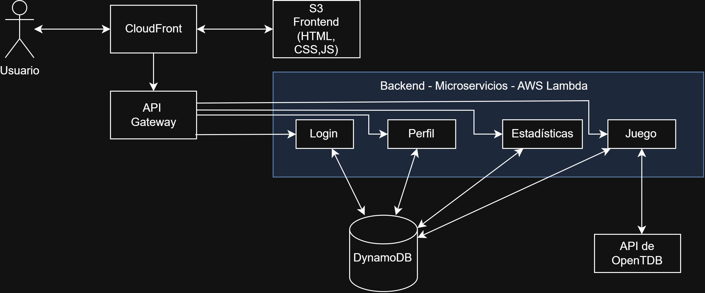

# Documentación del Hito 1

## Justificación NIST SP 800-145
- **Autoservicio bajo demanda:**    
La experiencia del usuario no se degrada aunque haya múltiples usuarios a la vez, ya que la nube reacciona inmediatamente asignando más recursos.

- **Acceso amplio a la red:**    
El sistema hace peticiones HTTPS con respuestas JSON. Esto permite que los usuarios puedan jugar o acceder a sus datos desde cualquier dispositivo.

- **Asignación común de recursos:**  
La infraestructura se comparte entre los distintos usuarios mediante multitenancy. Los microservicios operan de forma aislada sobre clústeres gestionados por el proveedor Cloud, asignando recursos físicos de forma dinámica según la carga de trabajo instantánea de la plataforma.

- **Rápida elasticidad:**
Al conectarse más jugadores simultáneamente, el microservicio se autoescala automáticamente para soportar las peticiones concurrentes. Al terminar una partida, las instancias se borran automáticamente para no malgastar recursos.

- **Servicio medido:**  
El consumo de infraestructura se supervisa y factura en tiempo real en base al uso exacto según el número de peticiones HTPPS, tiempo de cómputo en CPU por partida y gigabytes de datos transferidos. Así, es medible cuanto cuesta cada partida o usuario activo.

## Mapeo de Actores NIST SP 500-292
- `Consumidor:` Los clientes de la web
  
- `Proveedor:` La web de Trivial que proporcionamos
  
- `Intermediario:` Hipotéticamente sería una consultora ficticia que nos aconseje sobre qué servicios contratar, comparando precios y nos ayude a gestionar los recursos contratados.
  
- `Auditor:` Hipotéticamente sería una empresa auditora ficticia que nos revisaría la seguridad de la web, la protección de los datos y el cumplimiento de los requisitos.
  
- `Operador:` Las redes de comunicaciones que conectan a los clientes con los datacenters. Ej: Movistar, Vodafone, Telefónica, etc.

## Diagrama de Arquitectura
Se seguirá una arquitectura serverless basada en microservicios, que permitirá reducir la gestión de la infraestructura, facilitar la escalabilidad y la elasticidad de la aplicación, favorecer el desacoplamiento de sus componentes y ajustar los costes al uso de los servicios.  

Se hará uso de los servicios de AWS para desplegar la aplicación en la nube. El navegador se comunicará con CloudFront, que distribuirá el contenido de la página web almacenado en S3, un servicio de almacenamiento de objetos. Asimismo, CloudFront actuará como punto de entrada para las peticiones a la API, redirigiéndolas a API Gateway, que se encargará de encaminarlas a los microservicios correspondientes mediante la configuración de rutas e integraciones. CloudFront permitirá aplicar políticas de caché para mejorar el rendimiento, especialmente en la distribución de contenido estático.  

Los microservicios se implementarán mediante funciones AWS Lambda y se comunicarán con la base de datos para consultar y almacenar la información necesaria. Adicionalmente, el microservicio de Juego se comunicará con la API externa de OpenTDB para obtener las preguntas del Trivial.  

La base de datos será DynamoDB, un servicio de base de datos NoSQL gestionado por AWS. Se ha optado por esta tecnología por su integración con el ecosistema de AWS, su capacidad de escalado y su modelo de facturación, que puede resultar económico para una aplicación de este tamaño si se diseña adecuadamente.  

## Especificación de la API REST

A continuación, se expone una documentación sintética de los endpoints principales organizados por microservicios.

<ins>Login</ins>

| Método | Ruta | Payload JSON | Descripción |
| ---    | ---  |     ---      |   ---       |
| POST   | /auth/register | username, email, password | Registrar una nueva cuenta |
| POST   | /auth/login    | username o email, password | Iniciar sesión |

<ins>Perfil</ins>
| Método | Ruta | Payload JSON | Descripción |
| ---    | ---  |     ---      |   ---       |
| GET    | /profile/{id} | - | Consultar los datos de una cuenta |
| PATCH  | /profile/{id} | username, email, password | Cambiar los datos de una cuenta |
| DELETE | /profile/{id} | - | Elimina la cuenta de un usuario |

<ins>Juego</ins>
| Método | Ruta | Payload JSON | Descripción |
| ---    | ---  |     ---      |   ---       |
| POST   | /games | amount, category, difficulty, type | Crea un nuevo juego |
| POST   | /games/{game_id}/{round_num} | answer, category, difficulty, type, time | Guarda los datos de una respuesta |

<ins>Estadísticas</ins>
| Método | Ruta | Payload JSON | Descripción |
| ---    | ---  |     ---      |   ---       |
| GET    | /statistics/{id} | difficulty, category | Consultar las estadísticas de un perfil, con filtros opcionales |
