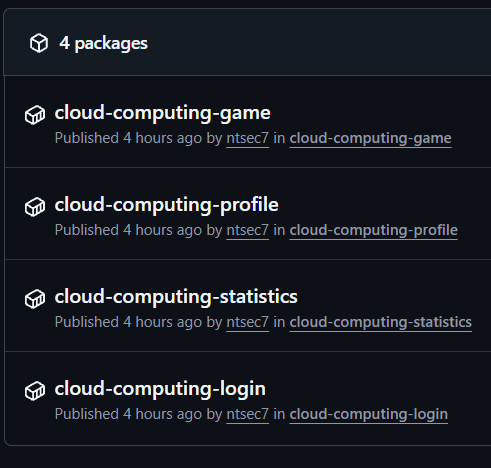
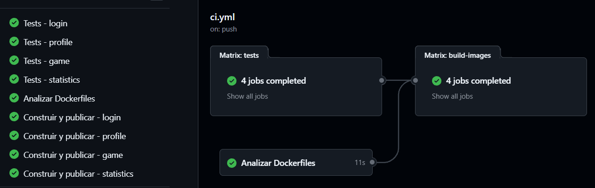
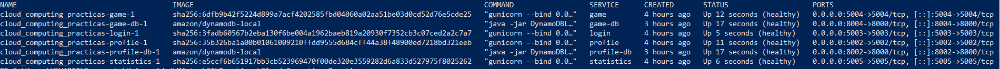

# Hito 2. Empaquetado Cloud Native, Entorno Local e Integración Continua (CI)

## 1. Objetivo

El objetivo de este hito es preparar los microservicios de la aplicación
para su ejecución mediante contenedores Docker, facilitar el desarrollo
y la ejecución conjunta en un entorno local mediante Docker Compose y
automatizar las comprobaciones del código a través de un flujo de
integración continua.

Para ello, se han creado imágenes Docker para los cuatro microservicios,
se ha definido un entorno local que incluye sus dependencias y bases de
datos, y se ha configurado un flujo de trabajo en GitHub Actions que
ejecuta pruebas, analiza el código y construye las imágenes de los
servicios.

## 2. Empaquetado de los microservicios

La aplicación está organizada en cuatro microservicios independientes:

-   **Login:** gestiona las operaciones de autenticación.
-   **Profile:** gestiona la información de los perfiles de usuario.
-   **Game:** gestiona las partidas y las respuestas de los usuarios.
-   **Statistics:** proporciona las estadísticas de las partidas.

Cada microservicio dispone de su propio archivo `Dockerfile`, situado en
el directorio correspondiente. De esta manera, cada servicio puede
empaquetarse y ejecutarse de forma independiente.

### 2.1. Construcción de las imágenes

Los Dockerfiles utilizan una construcción multietapa (*multi-stage
build*). Este enfoque permite separar las tareas de preparación e
instalación de dependencias de la etapa final de ejecución.

La construcción multietapa contribuye a:

-   Mantener separadas las fases de construcción y ejecución.
-   Evitar incluir en la imagen final elementos que solo son necesarios
    durante la preparación.
-   Obtener imágenes de ejecución más organizadas y adecuadas para su
    distribución.
-   Facilitar la reproducción del entorno de cada microservicio.

Las imágenes se construyen utilizando como contexto el directorio de
cada servicio y su correspondiente Dockerfile.

| Microservicio | Puerto de la aplicación | Dockerfile |
| --- | --- | --- |
| Profile | 5002 | `profile/Dockerfile` |
| Login | 5003 | `login/Dockerfile` |
| Game | 5004 | `game/Dockerfile` |
| Statistics | 5005 | `statistics/Dockerfile` |



### 2.2. Elección de la imagen base de Python
Para los microservicios desarrollados en Python se ha elegido la imagen
`python:3.12-slim` como imagen base. La etiqueta `3.12` fija la versión
principal y secundaria del intérprete utilizada por la aplicación, lo
que ayuda a mantener un entorno coherente entre el desarrollo, las
pruebas y la ejecución en contenedores.

La variante `slim` se basa en una distribución Debian reducida y
contiene menos paquetes que la imagen estándar de Python. Por ello,
permite partir de una imagen de menor tamaño y evita incorporar
herramientas y componentes que no son necesarios para ejecutar los
microservicios. Esta elección contribuye a reducir el tamaño de las
imágenes y la cantidad de componentes incluidos en ellas, manteniendo
una base compatible con las dependencias habituales de Python.

No se considera que `slim` sea necesariamente la imagen más pequeña en
todos los casos, sino una alternativa ligera y práctica para este
proyecto, en la que se prioriza el equilibrio entre tamaño y
compatibilidad.

## 3. Entorno local con Docker Compose

Para facilitar la ejecución conjunta de los componentes se ha definido
un archivo `docker-compose.yml` en la raíz del repositorio.

Docker Compose permite declarar los servicios, sus configuraciones, las
redes, los volúmenes y las dependencias en un único archivo. Así, el
entorno puede iniciarse y detenerse mediante comandos comunes, sin tener
que ejecutar cada contenedor manualmente.

### 3.1. Servicios del entorno

El entorno local está compuesto por los cuatro microservicios y dos
instancias de DynamoDB Local.

| Servicio | Función | Puerto publicado en el equipo anfitrión |
| --- | --- | --- |
| `login` | Autenticación | 5003 |
| `profile` | Gestión de perfiles | 5002 |
| `game` | Gestión de partidas | 5004 |
| `statistics` | Consulta de estadísticas | 5005 |
| `profile-db` | Persistencia de perfiles | 8002 |
| `game-db` | Persistencia de partidas | 8004 |

Los puertos publicados permiten acceder a los servicios desde el equipo
anfitrión. Para la comunicación entre contenedores se utilizan los
nombres de los servicios de Compose y los puertos internos
correspondientes.

Las bases de datos emplean DynamoDB Local, lo que permite desarrollar y
probar la aplicación sin depender de una instancia de DynamoDB
desplegada en AWS.

### 3.2. Elección de DynamoDB Local y servicios de AWS

Se ha elegido la imagen `amazon/dynamodb-local` para las bases de datos
del entorno de desarrollo. DynamoDB Local proporciona una implementación
local compatible con la API de Amazon DynamoDB, por lo que permite
realizar pruebas y desarrollar utilizando el mismo modelo de acceso a
datos que se empleará al desplegar la aplicación en AWS.

Esta elección facilita la transición entre el entorno local y el entorno
de despliegue, reduce la dependencia de recursos cloud durante el
 desarrollo y permite probar las operaciones de persistencia sin
necesidad de utilizar una tabla alojada en AWS. DynamoDB Local se utiliza
como entorno de desarrollo y pruebas; en el despliegue, la aplicación
podrá conectarse al servicio gestionado Amazon DynamoDB.

Para la autenticación se utiliza **Amazon Cognito**, un servicio
 gestionado de AWS para la gestión de usuarios y autenticación. Se ha
elegido por su integración con el ecosistema de AWS y porque permite
apoyarse en un servicio especializado para gestionar la identidad de los
usuarios, en lugar de implementar y mantener todo el mecanismo de
autenticación dentro de la aplicación. Esta integración resulta adecuada
para la arquitectura prevista, que se desplegará en AWS.

Cognito es un servicio cloud externo y no una de las bases de datos
locales levantadas por Docker Compose. Los microservicios se configuran
para comunicarse con él mediante los parámetros y credenciales
correspondientes, que deben mantenerse fuera del código fuente.

### 3.3. Configuración mediante variables de entorno

La configuración de los microservicios se realiza mediante variables de
entorno. Docker Compose carga los archivos `.env` específicos de cada
servicio y define las variables necesarias para la comunicación con
DynamoDB Local.

Esta configuración permite separar los parámetros de ejecución del
código fuente. Los archivos que contienen valores sensibles o
credenciales locales no deben incluirse en el repositorio.

### 3.4. Redes

Se han definido dos redes de tipo *bridge*:

-   **`profile-network`:** conecta los servicios relacionados con
    perfiles y autenticación, junto con la base de datos de perfiles.
-   **`game-network`:** conecta los servicios relacionados con partidas
    y estadísticas, junto con la base de datos de partidas.

Los servicios se conectan únicamente a las redes que necesitan. Esta
separación organiza la comunicación interna y evita conectar
indiscriminadamente todos los contenedores a una única red.

### 3.5. Persistencia de los datos

Para conservar los datos de DynamoDB Local se utilizan volúmenes Docker:

-   `profile-db-data`
-   `game-db-data`

Los volúmenes almacenan los archivos de las bases de datos fuera del
ciclo de vida de los contenedores. Por tanto, detener o recrear los
contenedores no implica necesariamente perder los datos almacenados.

El volumen `profile-db-data` se configura como externo, mientras que
`game-db-data` es gestionado por Docker Compose.

Para detener el entorno conservando los datos se utiliza:

``` powershell
docker compose down
```

No se debe utilizar `docker compose down -v` cuando se quiera conservar
la información de los volúmenes.

`profile-db-data` cuenta con la tabla de datos `Profile` con esta estructura:

| Atributo | Tipo | Función | Descripción |
| :--- | :--- | :--- | :--- |
| `user_id` | String (`S`) | Clave de partición (PK) | Identificador único del usuario, obtenido de Cognito. |
| `username` | String (`S`) | Atributo | Nombre de usuario de la cuenta. |
| `name` | String (`S`) | Atributo | Nombre del usuario. |
| `avatar_id` | String (`S`) | Atributo | Identificador del avatar seleccionado. |
| `role` | String (`S`) | Atributo | Rol del usuario, puede tomar los valores `client` o `admin`. |

Por su parte, `game-db-data` posee las siguientes tablas:

### Tabla `Games`

| Atributo | Tipo | Función | Descripción |
| :--- | :--- | :--- | :--- |
| `game_id` | String (`S`) | Clave de partición (PK) | Identificador único de la partida. |
| `user_id` | String (`S`) | PK del GSI (`UserIdIndex`) | Identificador del usuario que ha creado la partida. |
| `category` | Number (`N`) | Atributo | Categoría de las preguntas, identificada mediante el código numérico de OpenTDB o `None` para que sea aleatorio. |
| `difficulty` | String (`S`) | Atributo | Nivel de dificultad de la partida, puede valer `easy`, `medium`, `hard` o `None`. |
| `questions` | List (`L`) | Atributo | Lista de preguntas que componen la partida, incluyendo sus datos y respuestas posibles. |
| `current_question_index` | Number (`N`) | Atributo | Índice de la pregunta actual dentro de la partida. |
| `current_question_started_at` | String (`S`) | Atributo | Fecha y hora en la que comenzó la pregunta actual, utilizada para calcular el tiempo de respuesta. |
*(Nota: Esta tabla no utiliza clave de ordenación).*

#### Índice secundario global: `UserIdIndex`

| Parámetro | Valor |
| :--- | :--- |
| **Nombre** | `UserIdIndex` |
| **Clave de partición (PK)** | `user_id` |
| **Clave de ordenación (SK)** | No tiene |
| **Proyección** | `ALL` |

---

### Tabla `GameResponses`

| Atributo | Tipo | Función | Descripción |
| :--- | :--- | :--- | :--- |
| `user_id` | String (`S`) | Clave de partición (PK) | Identificador del usuario que ha respondido. |
| `response_id` | String (`S`) | Clave de ordenación (SK) | Identificador compuesto por `game_id#question_id`, que permite identificar la respuesta dentro de una partida. |
| `game_id` | String (`S`) | Atributo | Identificador de la partida a la que pertenece la respuesta. |
| `question_id` | String (`S`) | Atributo | Identificador de la pregunta respondida. |
| `is_correct` | Boolean (`BOOL`) | Atributo | Indica si la respuesta del usuario ha sido correcta. |
| `response_time_ms` | Number (`N`) | Atributo | Tiempo empleado en responder, expresado en milisegundos. |

### 3.6. Healthchecks y dependencias

Se han incorporado *healthchecks* a los cuatro microservicios y a las
dos instancias de DynamoDB Local.

Los healthchecks permiten comprobar periódicamente si los servicios
responden y comunicar a Docker su estado de salud. Un contenedor puede
estar iniciado y, aun así, no encontrarse preparado para atender
peticiones; por eso resulta útil distinguir entre el estado de ejecución
y el estado de salud.

En los microservicios se comprueba la disponibilidad de sus endpoints de
salud. En DynamoDB Local se realiza una comprobación de respuesta HTTP
del servidor.

Además, se han configurado dependencias mediante `depends_on` y
`condition: service_healthy` para que los servicios que dependen de
otros esperen a que estos estén saludables antes de iniciar su
ejecución.

## 4. Integración continua (CI)

La integración continua se ha configurado mediante GitHub Actions. El
workflow se encuentra en:

`/.github/workflows/ci.yml`

El flujo se ejecuta ante eventos de `push` y `pull_request` dirigidos a
la rama configurada en el workflow. Su finalidad es detectar problemas
de forma automática antes de integrar cambios y mantener un proceso
reproducible de validación y construcción.



### 4.1. Ejecución de pruebas

El workflow incluye un trabajo de pruebas para los microservicios. Se
utiliza una matriz para ejecutar las comprobaciones de cada servicio de
forma independiente.

En cada ejecución se realizan, entre otras, las siguientes tareas:

1.  Descargar el repositorio.
2.  Configurar la versión de Python definida en el workflow.
3.  Instalar las dependencias del microservicio.
4.  Ejecutar las pruebas automatizadas con `pytest`.

El comando utilizado para ejecutar las pruebas es:

``` bash
python -m pytest -v
```

La matriz permite identificar de forma más sencilla qué microservicio
presenta un fallo, sin mezclar los resultados de todos ellos en una
única ejecución.

### 4.2. Análisis estático del código

También se realizan comprobaciones estáticas para mejorar la calidad y
consistencia del proyecto.

-   **Ruff:** analiza el código Python y detecta problemas de estilo y
    determinadas incidencias que pueden identificarse sin ejecutar la
    aplicación.
-   **Hadolint:** analiza los Dockerfiles y señala posibles
    incumplimientos de buenas prácticas en la definición de imágenes.

El análisis de los Dockerfiles se realiza mediante un trabajo específico
del workflow. De este modo, los errores de configuración de las imágenes
pueden detectarse antes de su construcción y publicación.

### 4.3. Construcción y publicación de imágenes

El workflow incorpora un trabajo para construir las imágenes Docker de
los cuatro microservicios. Este trabajo depende de que las pruebas y el
análisis de los Dockerfiles hayan finalizado correctamente.

Para la construcción se utilizan Docker Buildx y las acciones de Docker
disponibles en GitHub Actions.

El proceso incluye:

1.  Descargar el repositorio.
2.  Configurar Docker Buildx.
3.  Generar las etiquetas de las imágenes.
4.  Construir la imagen correspondiente a cada microservicio.
5.  Publicar las imágenes en GitHub Container Registry (GHCR) cuando se
    cumple la condición de publicación configurada.

Las imágenes se identifican mediante el nombre del repositorio y del
microservicio, y se generan etiquetas que permiten distinguir las
versiones publicadas.

La automatización de este proceso evita tener que construir y publicar
manualmente las imágenes después de cada actualización válida del
código.

## 5. Puesta en marcha y verificación del entorno

### 5.1. Requisitos previos

Para ejecutar el entorno local es necesario disponer de:

-   Git.
-   Docker Desktop.
-   Docker Compose, incluido en las instalaciones actuales de Docker
    Desktop.

### 5.2. Inicio del entorno

Desde la raíz del repositorio se puede construir e iniciar el entorno
con:

``` powershell
docker compose up -d --build
```

Este comando construye las imágenes locales cuando es necesario y
arranca los servicios definidos en el archivo Compose.

### 5.3. Comprobación del estado

Para consultar el estado de los contenedores se utiliza:

``` powershell
docker compose ps
```

La salida permite comprobar qué servicios están ejecutándose y, dado que
tienen configurado un healthcheck, si se encuentran saludables.



También se puede consultar el estado de un servicio concreto o revisar
sus registros mediante:

``` powershell
docker compose logs <servicio>
```

### 5.4. Detención del entorno

Para detener y eliminar los contenedores del entorno local se utiliza:

``` powershell
docker compose down
```

Los volúmenes no se eliminan con este comando, por lo que los datos
persistentes se conservan.

## 6. Conclusiones

En este hito se ha preparado la aplicación para ejecutarse en un entorno
contenerizado y reproducible. Cada microservicio dispone de su propia
imagen Docker y Docker Compose permite levantar conjuntamente los
servicios y sus dependencias locales.

La configuración de redes y volúmenes organiza la comunicación entre
componentes y permite conservar los datos de DynamoDB Local. Los
healthchecks y las dependencias de disponibilidad mejoran el orden de
arranque y la supervisión básica de los contenedores.

Por último, el workflow de GitHub Actions automatiza las pruebas, el
análisis estático y la construcción de imágenes, incorporando un proceso
de validación continua que facilita mantener la calidad del proyecto a
medida que evoluciona.
